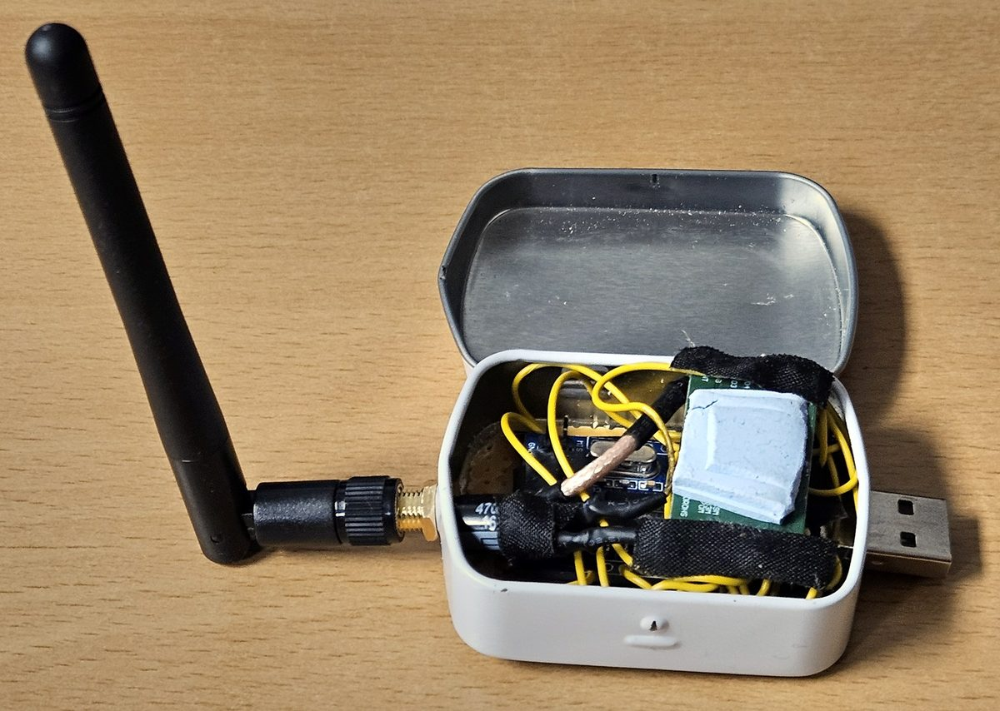
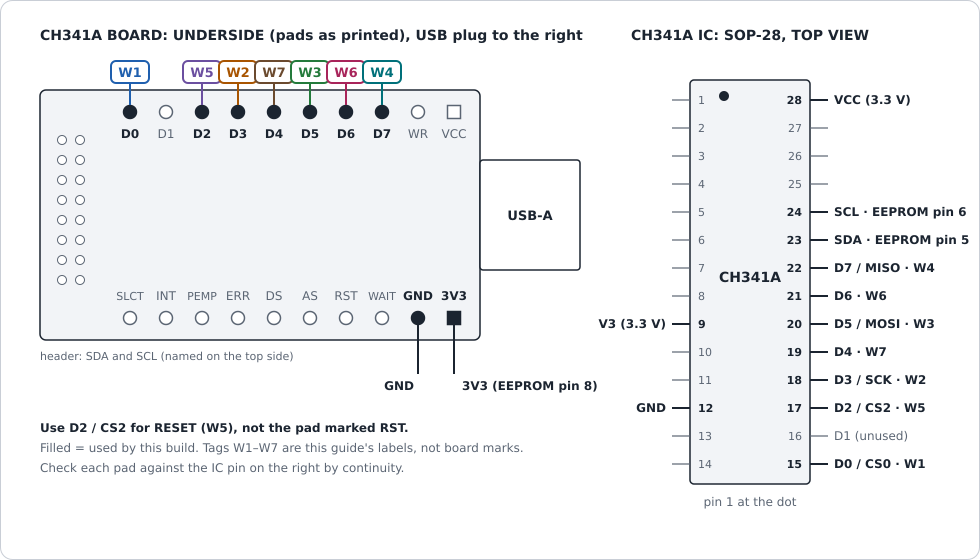
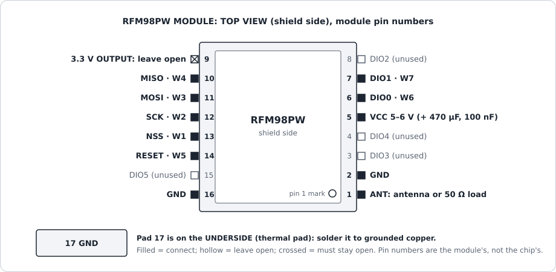
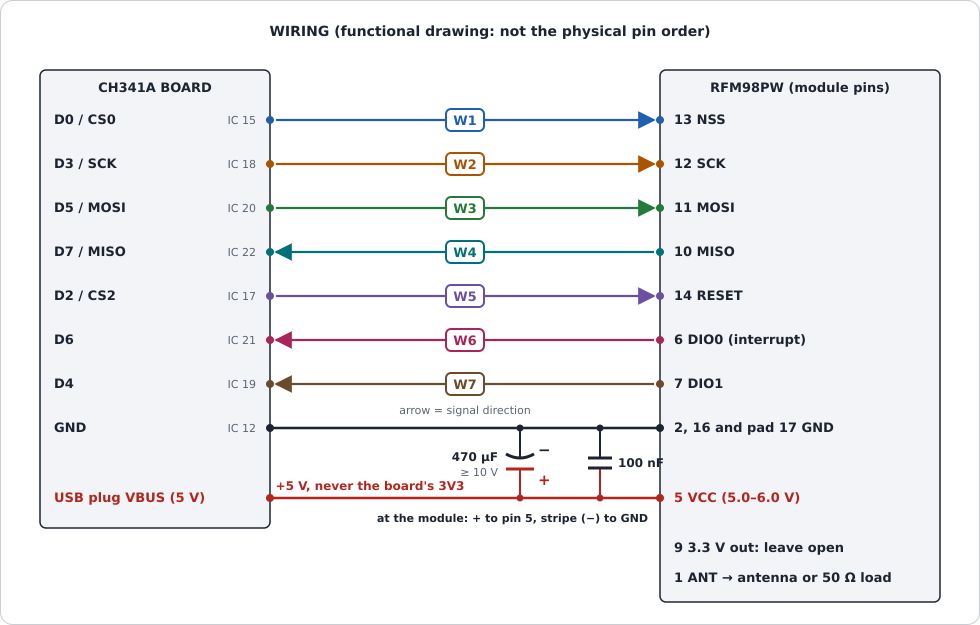
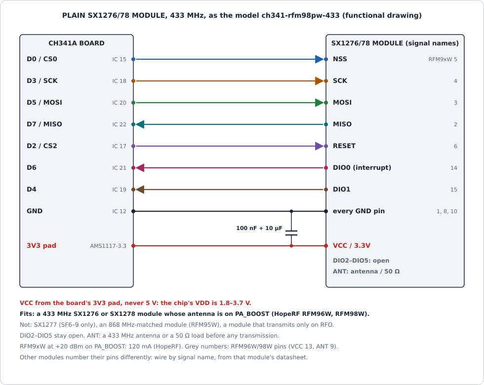
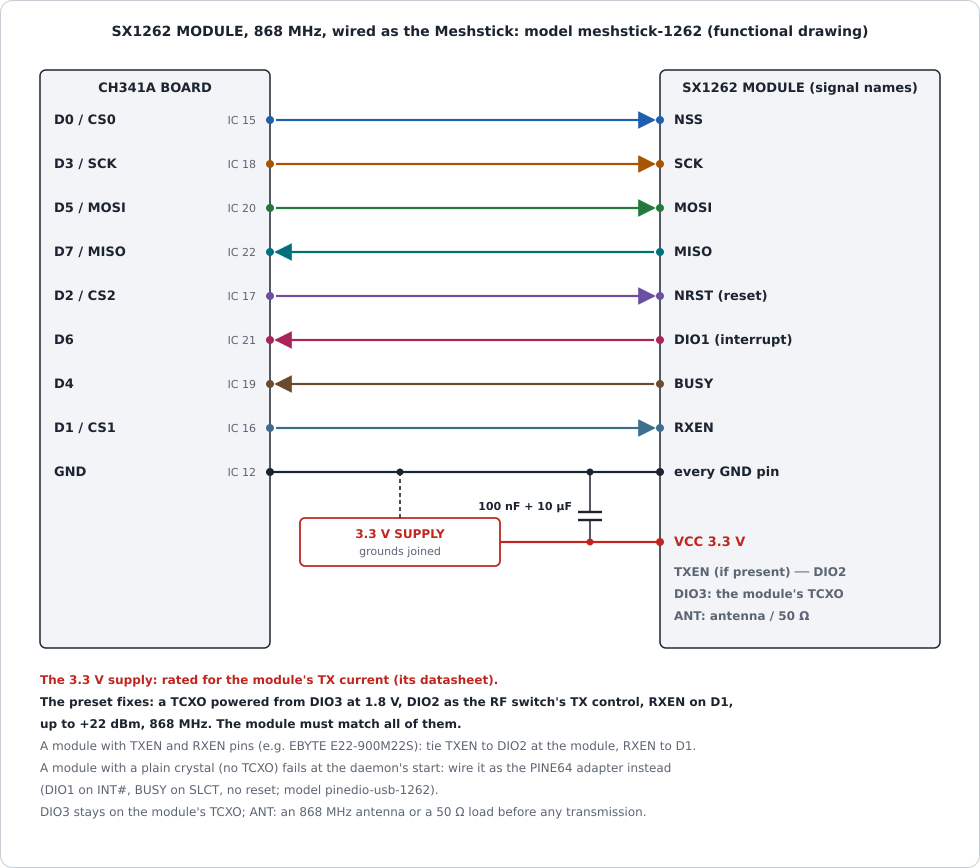
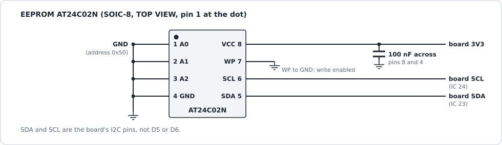

# Building a LoRa USB radio: CH341A + LoRa module

A self-built LoRa USB radio: a CH341A USB-to-SPI board, an AT24C02N EEPROM that gives the stick its own
serial, and a LoRa module.

> [!WARNING]
> **Licence.** Built with the RFM98PW (about 1 W at 433 MHz), this stick is an amateur radio transmitter
> and needs an amateur radio licence. Built with an 868 MHz SX1262 module instead (see
> [step 2](#sx1262-module-33-v-868-mhz)), it may also be used on the licence-free 868 MHz SRD
> frequencies, within their limits ([band limits](stacks/reticulum.md#band-limits)). You are responsible for
> complying with your local regulations.



## Parts and tools

### Radio module: three to choose from

| module | chip | band | supply | LHPC model |
|---|---|---|---|---|
| HopeRF RFM98PW (high power, about 1 W) | SX127x with an extra PA | 433 MHz | **5 V** | `ch341-rfm98pw-433` |
| a plain SX1276/78 module | SX127x | 433 MHz | 3.3 V | `ch341-rfm98pw-433` |
| an SX1262 module | SX1262 | 868 MHz | 3.3 V | `meshstick-1262` or `pinedio-usb-1262` |

Only the RFM98PW needs the 5 V feed of step 1 and the 5 V power of step 3; each module has its own part
in [step 2](#2-wire-the-radio). The model `ch341-rfm98pw-433` needs LoRaHAM daemon >= 1.4.0 (see the
[changelog](../CHANGELOG.md) for the release that ships it). Mount the module on a carrier with a ground
plane, and use an antenna for its band or a 50 Ω dummy load.

### USB board and EEPROM

- A CH341A USB-to-SPI board, sold as "CH341A module USB to SPI" (MPN `UTTL_IIC_SPI`): the kind with two
  3V3/5V voltage jumpers, an I2C-SPI/UART mode jumper and the two pad rows shown in step 1. The pad and
  jumper names below are that board's; check yours by its silk labels and by continuity.
  It reports the USB id `1a86:5512`, like the other [USB radios](usb-radios.md).
- An AT24C02N EEPROM (256 bytes, SOIC-8; every grade runs at 3.3 V) and a 100 nF ceramic capacitor.

### Capacitors

- For the RFM98PW: a 470 µF electrolytic capacitor (10 V or more; 16 V used) and a second 100 nF ceramic.
- For a 3.3 V module: a 100 nF and a 22 µF capacitor (it runs from the board's 3V3).

### Tools

- A multimeter, fine soldering tools and short insulated wires.
- Keep power off while soldering, and handle the parts ESD-safe: work on a grounded mat or with a wrist
  strap, and touch ground before you touch the CH341A board, the EEPROM or the radio module.

## Contents

- [1. Prepare the CH341 board](#1-prepare-the-ch341-board)
- [2. Wire the radio](#2-wire-the-radio)
- [3. Power and capacitors](#3-power-and-capacitors)
- [4. Solder the EEPROM](#4-solder-the-eeprom)
- [5. Program the EEPROM](#5-program-the-eeprom)
- [6. Boot from the EEPROM](#6-boot-from-the-eeprom)
- [7. First test at low power](#7-first-test-at-low-power)

## 1. Prepare the CH341 board



Start with USB unplugged and nothing attached:

1. Set **both** voltage jumper caps (at the USB end) to **3V3**. All signal lines in this build are
   3.3 V logic; the radio's digital inputs must stay below 3.6 V.
2. Set the mode jumper to **I2C-SPI** for the first checks and for programming a blank EEPROM
   ([steps 4–5](#4-solder-the-eeprom)).
3. Plug in USB with only this board attached and check the id: `lsusb -d 1a86:5512` must show one
   line. `1a86:5523` means UART mode: unplug and check the mode jumper.
4. Measure against the IC, not against a header numbering: CH341A pin 12 is GND, pins 28 and 9 are on
   the 3.3 V supply (each about 3.3 V with USB on; near 5 V means the voltage caps are wrong — unplug).
5. **(RFM98PW only) Find the 5 V pickup** with USB unplugged: the VBUS contact of the USB plug, found by continuity, or
   a rated USB breakout. The pads printed VCC follow the voltage jumpers and are 3.3 V here, not 5 V.
   Continuity does not prove a pad's current rating; if it is unknown, use the breakout.
6. **(RFM98PW only) Check the feed alone**, before any radio wire is on: solder the feed wire to the pickup and leave
   its far end free. With USB on, measure at that end against a board GND pad: 5.0–6.0 V, with the
   right polarity. Unplug, then insulate the end. (Checked now, the board never runs with its signal
   wires on an unpowered radio.)

## 2. Wire the radio

With USB unplugged, wire the module by signal name to the board's underside D-line pads; the CH341A IC
pin numbers are for checking continuity. After soldering, check every wire end to end, every module GND
to the board GND, and each neighbour for a solder bridge, with power off. Wire your module by its part:

- [HopeRF RFM98PW (5 V, high power)](#hoperf-rfm98pw-5-v-high-power)
- [Plain SX127x module (3.3 V, 433 MHz)](#plain-sx127x-module-33-v-433-mhz)
- [SX1262 module (3.3 V, 868 MHz)](#sx1262-module-33-v-868-mhz)

### HopeRF RFM98PW (5 V, high power)

Tested by the author.





With USB unplugged, solder the seven signal wires and the grounds. The tags W1–W7 are this guide's
labels, not board markings. Use the board's underside D-line pads; the IC pin numbers are for checking
continuity. RFM98PW pin numbers are the module's (top view, shield side, as in HopeRF's drawing), not
the chip's.

| wire | CH341 pad | CH341A IC pin | RFM98PW pin |
|---|---|---|---|
| W1 | D0 / CS0 | 15 | 13 NSS |
| W2 | D3 / SCK | 18 | 12 SCK |
| W3 | D5 / MOSI | 20 | 11 MOSI |
| W4 | D7 / MISO | 22 | 10 MISO |
| W5 | D2 / CS2 | 17 | 14 RESET |
| W6 | D6 | 21 | 6 DIO0 (the interrupt) |
| W7 | D4 | 19 | 7 DIO1 |
| — | GND | 12 | 2, 16 and the underside pad 17 |

- RESET is **D2 / CS2**. Do not use the board's separate pad labelled RST.
- Compared with the Meshstick (an SX1262), D6 carries DIO0 instead of DIO1, and D4 carries DIO1 instead of
  BUSY: the SX127x has no BUSY line.
- Solder the underside pad 17 to grounded copper. Pin 1 (ANT) goes to the antenna or the dummy load.
  Pins 3, 4, 8 and 15 (DIO3, DIO4, DIO2, DIO5) stay open.
- After soldering, check every wire end to end, radio pins 2, 16 and pad 17 to the board GND, and each
  neighbour for a solder bridge, with power off.

### Plain SX127x module (3.3 V, 433 MHz)

Not tested by the author.

A plain 433 MHz SX1276/78 module (without the RFM98PW's extra PA) whose antenna is on PA_BOOST, the output
the daemon drives ([radio parameters](stacks/daemon.md#radio-parameters)). Its pin numbers and layout differ
from the RFM98PW's: wire it by signal name, as the model `ch341-rfm98pw-433`: NSS, SCK, MOSI, MISO, RESET,
DIO0, DIO1 and GND, on the same D-lines as the RFM98PW. Steps 1.5–1.6 do not apply; its capacitors and
power are in [step 3](#3-power-and-capacitors).



### SX1262 module (3.3 V, 868 MHz)

Not tested by the author.

An SX1262 module also needs BUSY and uses DIO1 where the SX127x uses DIO0. Wire it as one of the two
SX1262 [USB radios](usb-radios.md): the Meshstick (D0 NSS, D6 DIO1, D2 RESET, D4 BUSY, D1 RXEN; model
`meshstick-1262`) or the PINE64 adapter (D0 NSS, DIO1 on the status pin INT#, BUSY on SLCT, no RESET; model
`pinedio-usb-1262`), both 868 MHz models in LHPC. Each SX1262 model's daemon preset fixes that stick's pins,
TCXO and PA settings, so the module must match them. Steps 1.5–1.6 do not apply; its capacitors and
power are in [step 3](#3-power-and-capacitors).



## 3. Power and capacitors

### Capacitors (every module)

Solder them across the module's VCC and GND, as close to the module as possible.

| module | capacitors |
|---|---|
| HopeRF RFM98PW (VCC = pin 5) | a 470 µF electrolytic (its stripe, the minus side, to GND) and a 100 nF ceramic. The 470 µF carries the PA's current pulse of up to 700 mA at each transmission. Mind its inrush at plug-in: it can reset a hub and the devices on it. Plug the stick in first or use a powered hub; a small series resistor or NTC in the 5 V feed limits the inrush, but also drops voltage during the transmit pulse |
| a 3.3 V module (plain SX127x, SX1262) | a 22 µF (an electrolytic or tantalum one: its minus side to GND) and a 100 nF ceramic |

### Power: HopeRF RFM98PW (5 V, high power)

The module's VCC (pin 5) is fed **5 V directly** from USB, as in the reference build, by the feed
checked in step 1. Keep USB unplugged until point 2.

1. **Connect the feed to pin 5.** Never feed pin 5 from the board's 3.3 V. Pin 9 is the module's 3.3 V
   **output**: never tie it to anything.
2. At power-up, radio pin 5 must read 5.0–6.0 V and the board 3V3 about 3.3 V. Stop at a reversed or
   out-of-range supply. USB VBUS can sit below 5.0 V (a USB 2.0 port may give 4.75 V, less after the
   cable), which is under HopeRF's minimum. Plug in with `journalctl -k -f` open: an over-current or hub
   reset at plug-in means this port cannot feed the stick.

What the USB feed means:
- HopeRF specifies 650 mA typical and 700 mA maximum for the module alone at +30 dBm on 433 MHz, plus
  the bridge's own current.
- The stick's USB descriptor asks the host for 100 mA, and a USB 2.0 device gets no more than 500 mA
  from a standard port.
- So start at the **lowest** transmit power and watch the kernel log (`journalctl -k -f`) for a USB
  disconnect or an over-current message.
- **Warning:** at full power the module alone draws up to 700 mA, more than a USB port supplies. Full power
  needs a separate supply, which this guide does not cover: with two supplies the signal lines need
  isolation, so that neither side drives the other while it is unpowered.
- At any power, keep transmissions short, check the module's temperature, and see the licence note at the
  top.

### Power: 3.3 V modules

Feed VCC from the board's 3V3 pad, never 5 V. This board's 3.3 V regulator is an AMS1117-3.3 (rated 1 A;
check the marking on yours). Such a module draws a fraction of the RFM98PW's current (HopeRF's RFM9xW:
120 mA at +20 dBm), well within USB's 500 mA and the regulator's rating, so the RFM98PW's power problem
does not arise.

## 4. Solder the EEPROM

The EEPROM holds the CH341's USB configuration, including an eight-character serial that tells this
stick apart from every other `1a86:5512` device. It holds no radio firmware.

The EEPROM is optional. Without it, leave the mode jumper on **I2C-SPI** for good (removed, the CH341 starts
in UART mode, `1a86:5523`) and skip steps 4–6. The stick then has no serial, so LHPC identifies it by its
USB port: keep it on the same port ([USB radios](usb-radios.md)).



| AT24C02N pin | connect to |
|---|---|
| 1 A0, 2 A1, 3 A2 | GND (I2C address 0x50) |
| 4 GND | GND |
| 5 SDA | the board's SDA header pin (CH341A IC pin 23) |
| 6 SCL | the board's SCL header pin (CH341A IC pin 24) |
| 7 WP | GND (write enabled) |
| 8 VCC | the board's 3V3, with 100 nF from pin 8 to pin 4 |

SDA and SCL are not D5 or D6. Add 4.7 kΩ pull-ups to 3.3 V on SDA and SCL only if the idle lines do
not sit near 3.3 V with USB on.

## 5. Program the EEPROM

The reference EEPROM was programmed with the radio wired and on USB 5 V. Keep the mode jumper on
**I2C-SPI**, and keep only this CH341 plugged in: the tool opens the first `1a86:5512` it finds.

1. Build the tool at the commit the guide checked:

   ```bash
   sudo apt install git build-essential libusb-1.0-0-dev python3 usbutils
   git clone https://github.com/command-tab/ch341eeprom.git
   cd ch341eeprom
   git checkout --detach 7cffbef7552d93162bd90cae836a45e94acb93fb
   make CC=gcc
   ```

2. **Back up twice before writing.** The tool can exit 0 on an error, so compare the files rather than
   trust its exit status:

   ```bash
   ./ch341eeprom -v -s 24c02 -r backup-a.bin
   ./ch341eeprom -v -s 24c02 -r backup-b.bin
   python3 -c "import pathlib as p; a=p.Path('backup-a.bin').read_bytes(); b=p.Path('backup-b.bin').read_bytes(); assert len(a)==len(b)==256 and a==b; print('PASS')"
   ```

   If your user cannot open the device, run the tool with `sudo`. Keep a copy of `backup-a.bin` outside
   this directory. An all-`FF` dump is a blank chip, or a failed read.

3. **Create the image** (256 bytes: signature and the parallel mode (12h) that carries SPI, VID 1A86, PID 5512, release 0100, the serial
   at 0x10). Choose a different eight-character serial for every stick:

   ```bash
   python3 - <<'PY'
   from pathlib import Path
   serial = b'LH433001'                       # exactly 8 printable ASCII characters
   assert len(serial) == 8 and all(0x21 <= c <= 0x7e for c in serial)
   image = bytearray(256)
   image[0:10] = bytes.fromhex('53 12 DC 00 86 1A 12 55 00 01')
   image[0x10:0x18] = serial
   Path('loraham-24c02.bin').write_bytes(image)
   for o in (0x00, 0x10):
       print(f'{o:02X}:', image[o:o+16].hex(' '))
   PY
   ```

   For the example serial the two rows read
   `00: 53 12 dc 00 86 1a 12 55 00 01 00 …` and `10: 4c 48 34 33 33 30 30 31 00 …`.

4. **Write once, then verify into a new file:**

   ```bash
   ./ch341eeprom -v -s 24c02 -w loraham-24c02.bin
   ./ch341eeprom -v -s 24c02 -r readback-01.bin
   python3 -c "import pathlib as p; assert p.Path('loraham-24c02.bin').read_bytes()==p.Path('readback-01.bin').read_bytes(); print('PASS')"
   ```

   Do not unplug during the write. If it fails, check 3.3 V on EEPROM pin 8, WP at 0 V, idle SDA/SCL,
   the address pins and the chip's orientation. Name each new readback file differently (02, 03 …).

## 6. Boot from the EEPROM

Measured on the reference board:

| mode jumper | the CH341 at power-up |
|---|---|
| on **I2C-SPI** | ignores the EEPROM: bcdDevice 3.04, **no serial** |
| **removed** | loads the EEPROM: bcdDevice 1.00 and your serial |

1. Unplug, **remove the mode jumper** (normal use), plug in, and check that the serial is there:
   `lsusb -d 1a86:5512 -v | grep -i iserial`.
2. Pass: your serial survives a second unplug and replug. With `5523`, the EEPROM was not loaded: check its SDA/SCL
   wiring and contents. With `5512` and no serial, the mode jumper is still on.

Rewrites also work with the jumper removed (the stick stays `1a86:5512`). Programming a *blank* EEPROM
with the jumper removed was not tested. To restore the old contents, write `backup-a.bin` as in step 5
and verify it.

## 7. First test at low power

LHPC's one-time USB setup gives your user access to the stick (the console's Hardware page shows it
when the host needs it). The build needs no driver blacklist.

1. **Only the bare daemon on this radio.** Stop every client stack that runs on it (`lhpc stack stop
   <stack>@<rid>`; `lhpc status` lists them), and make this stick the only enabled radio in the hardware
   list: the TX test in point 5 sends on every band the daemon serves.
2. **Save the lowest power first**, before anything starts: `lhpc config daemon@<rid> --daemon-param
   POWER=2`. 2 is the daemon's floor on an SX127x; on an SX1262 it is 0 (`POWER=0`; the daemon's SX1262 range
   is 0–20, [radio parameters](stacks/daemon.md#radio-parameters)).
3. **Start the daemon:** `lhpc stack start daemon@<rid>` (`restart` if it already runs). The start must
   print `[ok] 433: POWER=2 sent` (an SX1262: `[ok] 868: POWER=0 sent`). A `[keep]` line (a client stack
   still runs), a `[warn]` or no such line means the lowest power is not applied: do not transmit. The radio must then reach READY (`lhpc status daemon`),
   which is the SPI check. The reference build's own check read the RFM98PW's version register (0x42)
   as `0x12`; an SX1262 has no such register.
4. **Receive first.** Set a known-good peer's values (on the stick's band) on the daemon (`lhpc config daemon@<rid>
   --daemon-param FREQ=… --daemon-param SF=…`, then `--apply-daemon`): frequency, bandwidth, spreading
   factor, coding rate, sync word, preamble and CRC. Its frames must show in `lhpc daemon <rid> --feed`
   or in the RF log `logs/<rid>/rf-daemon.log`. These are the peer's settings: the reference build's peer
   sent MeshCom frames at 433.175 MHz, SF11, BW 250 kHz, CR 4/6, sync 0x2B, preamble 16, which is not
   LHPC's MeshCom profile.
5. **Then transmit one frame at that power**, into an antenna or a dummy load rated above the expected
   power: `lhpc test daemon --tx --yes`. It sets no power of its own, so the frame goes out at the lowest power; it
   needs the operator call sign. The daemon does not report the power back: the evidence of the lowest
   power is the `[ok]` line of point 3 and an outside measurement (a power meter, or a peer's RSSI). Watch the kernel
   log for a USB disconnect, and check the module's temperature. The reference build sent one MeshCom
   frame at the lowest drive, without a USB event.
6. Before you trust the build, check that TX returns to RX, that a daemon restart works, and that the
   stick comes back after an unplug. A client stack started later on this radio sets its own POWER:
   check it in that stack's settings before it transmits.
