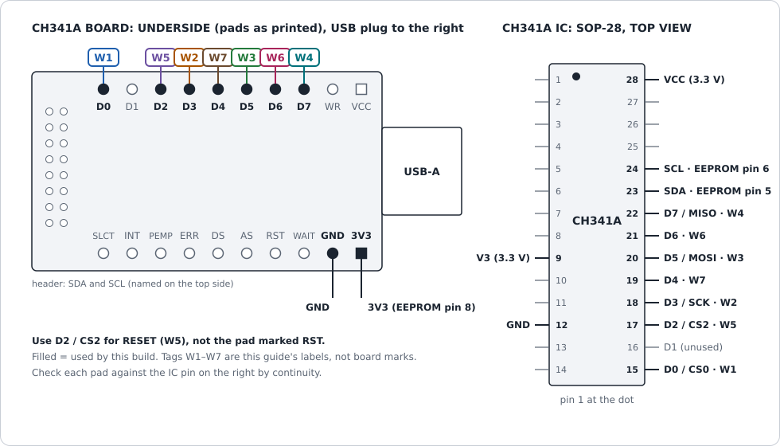
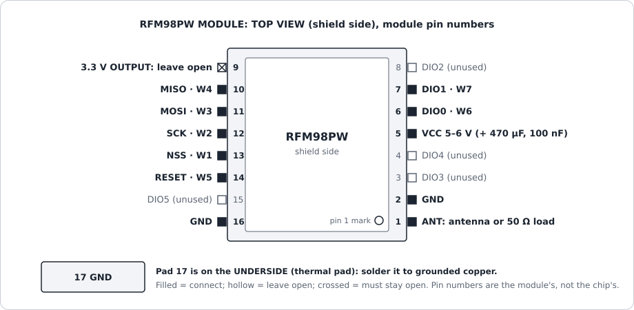
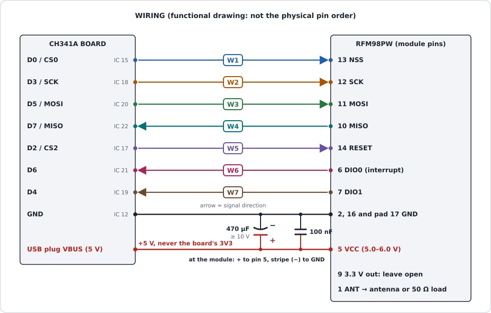
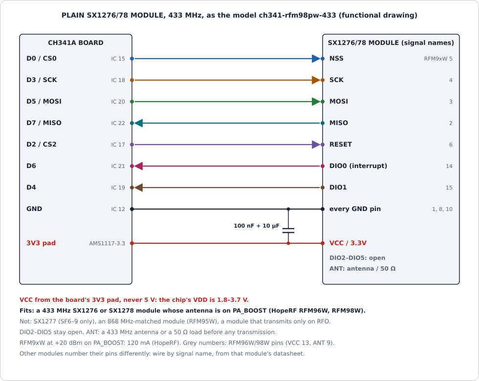
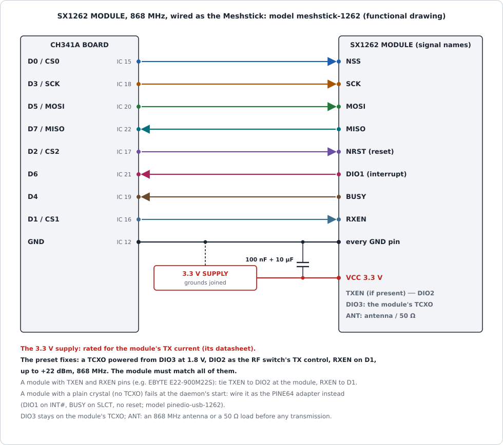

# Building a 433 MHz USB radio: CH341A + RFM98PW

A self-built USB radio: a CH341A USB-to-SPI board, an AT24C02N EEPROM that gives the stick its own
serial, and a HopeRF RFM98PW (SX127x, 433 MHz, high power). It reports the USB id `1a86:5512`, like
the other [USB radios](usb-radios.md). In LHPC it is the model `ch341-rfm98pw-433`, which needs
LoRaHAM daemon 1.4.0 (see the [changelog](../CHANGELOG.md) for the release that ships it).

Keep power off while soldering, and handle the parts ESD-safe: work on a grounded mat or with a wrist
strap, and touch ground before you touch the CH341A board, the EEPROM or the radio module.

**! Licence.** Built with the RFM98PW (about 1 W at 433 MHz), this stick is an amateur radio transmitter
and needs an amateur radio licence. Built with an 868 MHz SX1262 module instead (see
[other radio modules](#other-radio-modules)), it may also be used on the licence-free 868 MHz SRD
frequencies, within their limits ([band limits](stacks/reticulum.md#band-limits)). You are responsible for
complying with your local regulations.

## Contents

- [1. Parts and tools](#1-parts-and-tools)
- [2. Prepare the CH341 board](#2-prepare-the-ch341-board)
- [3. Wire the radio](#3-wire-the-radio)
- [4. Power and capacitors](#4-power-and-capacitors)
- [5. Solder the EEPROM](#5-solder-the-eeprom)
- [6. Program the EEPROM](#6-program-the-eeprom)
- [7. Boot from the EEPROM](#7-boot-from-the-eeprom)
- [8. First test at low power](#8-first-test-at-low-power)
- [Other radio modules](#other-radio-modules)

## 1. Parts and tools

- A CH341A USB-to-SPI board, sold as "CH341A module USB to SPI" (MPN `UTTL_IIC_SPI`): the kind with two
  3V3/5V voltage jumpers, an I2C-SPI/UART mode jumper and the two pad rows shown in step 2. The pad and
  jumper names below are that board's; check yours by its silk labels and by continuity.
- An AT24C02N EEPROM (256 bytes, SOIC-8, 2.7–5.5 V; run it at 3.3 V) and a 100 nF ceramic capacitor.
- A HopeRF RFM98PW module on a carrier with a ground plane, a 433 MHz antenna or a 50 Ω dummy load.
- Other radio modules: see [other radio modules](#other-radio-modules).
- A 470 µF electrolytic capacitor (10 V or more; 16 V used) and a second 100 nF ceramic.
- A multimeter, fine soldering tools and short insulated wires.

## 2. Prepare the CH341 board



Start with USB unplugged and nothing attached:

1. Set **both** voltage jumper caps (at the USB end) to **3V3**. All signal lines in this build are
   3.3 V logic; the radio's digital inputs must stay below 3.6 V.
2. Set the mode jumper to **I2C-SPI** for the first checks and for programming a blank EEPROM.
3. Plug in USB with only this board attached and check the id: `lsusb -d 1a86:5512` must show one
   line. `1a86:5523` means UART mode: unplug and check the mode jumper.
4. Measure against the IC, not against a header numbering: CH341A pin 12 is GND, pins 28 and 9 are on
   the 3.3 V supply (each about 3.3 V with USB on; near 5 V means the voltage caps are wrong — unplug).
5. **Find the 5 V pickup** with USB unplugged: the VBUS contact of the USB plug, found by continuity, or
   a rated USB breakout. The pads printed VCC follow the voltage jumpers and are 3.3 V here, not 5 V.
   Continuity does not prove a pad's current rating; if it is unknown, use the breakout.
6. **Check the feed alone**, before any radio wire is on: solder the feed wire to the pickup and leave
   its far end free. With USB on, measure at that end against a board GND pad: 5.0–6.0 V, with the
   right polarity. Unplug, then insulate the end. (Checked now, the board never runs with its signal
   wires on an unpowered radio.)

## 3. Wire the radio





With USB unplugged, solder the seven signal wires and the grounds. The tags W1–W7 are this guide's
labels, not board markings. Use the board's underside D-line pads; the IC pin numbers are for checking
continuity. RFM98PW pin numbers are the module's (top view, shield side, as in HopeRF's drawing), not
the chip's.

| wire | CH341 pad | CH341A IC pin | RFM98PW pin |
|---|---|---|---|
| W1 | D0 / CS0 | 15 | 13 NSS |
| W2 | D3 / SCK | 18 | 12 SCK |
| W3 | D5 / MOSI | 20 | 11 MOSI |
| W4 | D7 / MISO | 22 | 10 MISO |
| W5 | D2 / CS2 | 17 | 14 RESET |
| W6 | D6 | 21 | 6 DIO0 (the interrupt) |
| W7 | D4 | 19 | 7 DIO1 |
| — | GND | 12 | 2, 16 and the underside pad 17 |

- RESET is **D2 / CS2**. Do not use the board's separate pad labelled RST.
- Compared with the Meshstick (an SX1262), D6 carries DIO0 instead of DIO1, and D4 carries DIO1 instead of
  BUSY: the SX127x has no BUSY line.
- Solder the underside pad 17 to grounded copper. Pin 1 (ANT) goes to the antenna or the dummy load.
  Pins 3, 4, 8 and 15 (DIO3, DIO4, DIO2, DIO5) stay open.
- After soldering, check every wire end to end, radio pins 2, 16 and pad 17 to the board GND, and each
  neighbour for a solder bridge, with power off.

## 4. Power and capacitors

The module's VCC (pin 5) is fed **5 V directly** from USB, as in the reference build, by the feed
checked in step 2. Keep USB unplugged until point 3.

1. **Solder the capacitors** across VCC (pin 5) and GND, as close to the module as possible: the 470 µF
   electrolytic (its stripe, the minus side, to GND) and the 100 nF ceramic. They buffer the PA's current
   pulse at each transmission.
2. **Connect the feed to pin 5.** Never feed pin 5 from the board's 3.3 V. Pin 9 is the module's 3.3 V
   **output**: never tie it to anything.
3. At power-up, radio pin 5 must read 5.0–6.0 V and the board 3V3 about 3.3 V. Stop at a reversed or
   out-of-range supply. USB VBUS can sit below 5.0 V (a USB 2.0 port may give 4.75 V, less after the
   cable), which is under HopeRF's minimum: the fix is a regulated supply. Plug in with
   `journalctl -k -f` open: the 470 µF is far above the 10 µF USB 2.0 allows a device at attach, and an
   over-current or hub reset at plug-in also means the separate supply.

What the USB feed means:
- HopeRF specifies 650 mA typical and 700 mA maximum for the module alone at +30 dBm on 433 MHz, plus
  the bridge's own current.
- The stick's USB descriptor asks the host for 100 mA, and a USB 2.0 device gets no more than 500 mA
  from a standard port.
- So start at the **lowest** transmit power and watch the kernel log (`journalctl -k -f`) for a USB
  disconnect or an over-current message.
- A separately regulated 5–6 V supply rated for at least 1 A (the module's 700 mA maximum plus margin),
  with the grounds joined and its positive never tied to USB VBUS, is the alternative for high power.
  Switch it on before you plug in USB, and unplug USB before you switch it off.
- At any power, keep transmissions short, check the module's temperature, and see the licence note at the
  top.

## 5. Solder the EEPROM

The EEPROM holds the CH341's USB configuration, including an eight-character serial that tells this
stick apart from every other `1a86:5512` device. It holds no radio firmware. Its wiring is the lower
part of the drawing in [step 3](#3-wire-the-radio).

| AT24C02N pin | connect to |
|---|---|
| 1 A0, 2 A1, 3 A2 | GND (I2C address 0x50) |
| 4 GND | GND |
| 5 SDA | the board's SDA header pin (CH341A IC pin 23) |
| 6 SCL | the board's SCL header pin (CH341A IC pin 24) |
| 7 WP | GND (write enabled) |
| 8 VCC | the board's 3V3, with 100 nF from pin 8 to pin 4 |

SDA and SCL are not D5 or D6. Add 4.7 kΩ pull-ups to 3.3 V on SDA and SCL only if the idle lines do
not sit near 3.3 V with USB on.

## 6. Program the EEPROM

The reference EEPROM was programmed with the radio wired and on USB 5 V. Keep the mode jumper on
**I2C-SPI**, and keep only this CH341 plugged in: the tool opens the first `1a86:5512` it finds.

1. Build the tool at the commit the guide checked:

   ```bash
   sudo apt install git build-essential libusb-1.0-0-dev python3 usbutils
   git clone https://github.com/command-tab/ch341eeprom.git
   cd ch341eeprom
   git checkout --detach 7cffbef7552d93162bd90cae836a45e94acb93fb
   make CC=gcc
   ```

2. **Back up twice before writing.** The tool can exit 0 on an error, so compare the files rather than
   trust its exit status:

   ```bash
   ./ch341eeprom -v -s 24c02 -r backup-a.bin
   ./ch341eeprom -v -s 24c02 -r backup-b.bin
   python3 -c "import pathlib as p; a=p.Path('backup-a.bin').read_bytes(); b=p.Path('backup-b.bin').read_bytes(); assert len(a)==len(b)==256 and a==b; print('PASS')"
   ```

   If your user cannot open the device, run the tool with `sudo`. Keep a copy of `backup-a.bin` outside
   this directory. An all-`FF` dump is a blank chip, or a failed read.

3. **Create the image** (256 bytes: signature and SPI mode, VID 1A86, PID 5512, release 0100, the serial
   at 0x10). Choose a different eight-character serial for every stick:

   ```bash
   python3 - <<'PY'
   from pathlib import Path
   serial = b'LH433001'                       # exactly 8 printable ASCII characters
   assert len(serial) == 8 and all(0x21 <= c <= 0x7e for c in serial)
   image = bytearray(256)
   image[0:10] = bytes.fromhex('53 12 DC 00 86 1A 12 55 00 01')
   image[0x10:0x18] = serial
   Path('loraham-24c02.bin').write_bytes(image)
   for o in (0x00, 0x10):
       print(f'{o:02X}:', image[o:o+16].hex(' '))
   PY
   ```

   For the example serial the two rows read
   `00: 53 12 dc 00 86 1a 12 55 00 01 00 …` and `10: 4c 48 34 33 33 30 30 31 00 …`.

4. **Write once, then verify into a new file:**

   ```bash
   ./ch341eeprom -v -s 24c02 -w loraham-24c02.bin
   ./ch341eeprom -v -s 24c02 -r readback-01.bin
   python3 -c "import pathlib as p; assert p.Path('loraham-24c02.bin').read_bytes()==p.Path('readback-01.bin').read_bytes(); print('PASS')"
   ```

   Do not unplug during the write. If it fails, check 3.3 V on EEPROM pin 8, WP at 0 V, idle SDA/SCL,
   the address pins and the chip's orientation. Name each new readback file differently (02, 03 …).

## 7. Boot from the EEPROM

Measured on the reference board:

| mode jumper | the CH341 at power-up |
|---|---|
| on **I2C-SPI** | ignores the EEPROM: bcdDevice 3.04, **no serial** |
| **removed** | loads the EEPROM: bcdDevice 1.00 and your serial |

1. Unplug, **remove the mode jumper** (normal use), plug in, and check that the serial is there:
   `lsusb -d 1a86:5512 -v | grep -i iserial`.
2. Pass: your serial survives a second unplug and replug. With `5512` and no serial, the EEPROM was not
   loaded: check the jumper and the SDA/SCL wiring.

Rewrites also work with the jumper removed (the stick stays `1a86:5512`). Programming a *blank* EEPROM
with the jumper removed was not tested. To restore the old contents, write `backup-a.bin` as in step 6
and verify it.

## 8. First test at low power

LHPC's one-time USB setup gives your user access to the stick (the console's Hardware page shows it
when the host needs it). The build needs no driver blacklist.

1. **Only the bare daemon on this radio.** Stop every client stack that runs on it (`lhpc stack stop
   <stack>@<rid>`; `lhpc status` lists them), and make this stick the only enabled radio in the hardware
   list: the TX test in point 5 sends on every band the daemon serves.
2. **Save the lowest power first**, before anything starts: `lhpc config daemon@<rid> --daemon-param
   POWER=2`. 2 is the daemon's floor on an SX127x ([radio parameters](stacks/daemon.md#radio-parameters)).
3. **Start the daemon:** `lhpc stack start daemon@<rid>` (`restart` if it already runs). The start must
   print `[ok] 433: POWER=2 sent`. A `[keep]` line (a client stack still runs), a `[warn]` or no such line
   means the 2 is not applied: do not transmit. The radio must then reach READY (`lhpc status daemon`),
   which is the SPI check. The reference build's own check read the chip's version register (0x42) as
   `0x12`.
4. **Receive first.** Set a known-good 433 MHz peer's values on the daemon (`lhpc config daemon@<rid>
   --daemon-param FREQ=… --daemon-param SF=…`, then `--apply-daemon`): frequency, bandwidth, spreading
   factor, coding rate, sync word, preamble and CRC. Its frames must show in `lhpc daemon <rid> --feed`
   or in the RF log `logs/<rid>/rf-daemon.log`. These are the peer's settings: the reference build's peer
   sent MeshCom frames at 433.175 MHz, SF11, BW 250 kHz, CR 4/6, sync 0x2B, preamble 16, which is not
   LHPC's MeshCom profile.
5. **Then transmit one frame at that power**, into an antenna or a dummy load rated above the expected
   power: `lhpc test daemon --tx --yes`. It sets no power of its own, so the frame goes out at the 2; it
   needs the operator call sign. The daemon does not report the power back: the evidence of 2 is the
   `[ok]` line of point 3 and an outside measurement (a power meter, or a peer's RSSI). Watch the kernel
   log for a USB disconnect, and check the module's temperature. The reference build sent one MeshCom
   frame at the lowest drive, without a USB event.
6. Before you trust the build, check that TX returns to RX, that a daemon restart works, and that the
   stick comes back after an unplug. A client stack started later on this radio sets its own POWER:
   check it in that stack's settings before it transmits.

## Other radio modules

Not tested by the author.

A plain 433 MHz module (without the RFM98PW's extra PA) whose antenna is on PA_BOOST, the output the
daemon drives ([radio parameters](stacks/daemon.md#radio-parameters)), or an SX126x module (SX1262) can
take the RFM98PW's place, wired by signal name: its pin numbers and layout differ from the RFM98PW's.
Feed its VCC 3.3 V from a supply rated for the module's transmit current (its datasheet), never the 5 V
feed of step 4; the rating of the board's 3.3 V pads is unknown. For these 3.3 V modules the drawings
below replace steps 2.5–2.6, 3 and 4: the 5 V wire of step 2 is not made. The EEPROM steps 5–7 stay
the same.

- **SX127x (433 MHz):** the signals of step 3 (NSS, SCK, MOSI, MISO, RESET, DIO0, DIO1) and GND, as the
  model `ch341-rfm98pw-433`.

  

- **SX1262 (868 MHz):** also needs BUSY and uses DIO1 where the SX127x uses DIO0. Wire it as one of the
  two SX1262 [USB radios](usb-radios.md): the Meshstick (D0 NSS, D6 DIO1, D2 RESET, D4 BUSY, D1 RXEN;
  model `meshstick-1262`) or the PINE64 adapter (D0 NSS, DIO1 on the status pin INT#, BUSY on SLCT, no
  RESET; model `pinedio-usb-1262`), both 868 MHz models in LHPC. Each SX1262 model's daemon preset fixes
  that stick's pins, TCXO and PA settings, so the module must match them.

  

Step 8 applies with the module's own band: an SX1262 on 868 MHz takes 0 as its lowest `POWER` (the daemon's
SX1262 range is 0–20), its start prints `[ok] 868: POWER=0 sent`, it needs an 868 MHz peer, and it has no
0x42 version register: READY is the SPI check.
